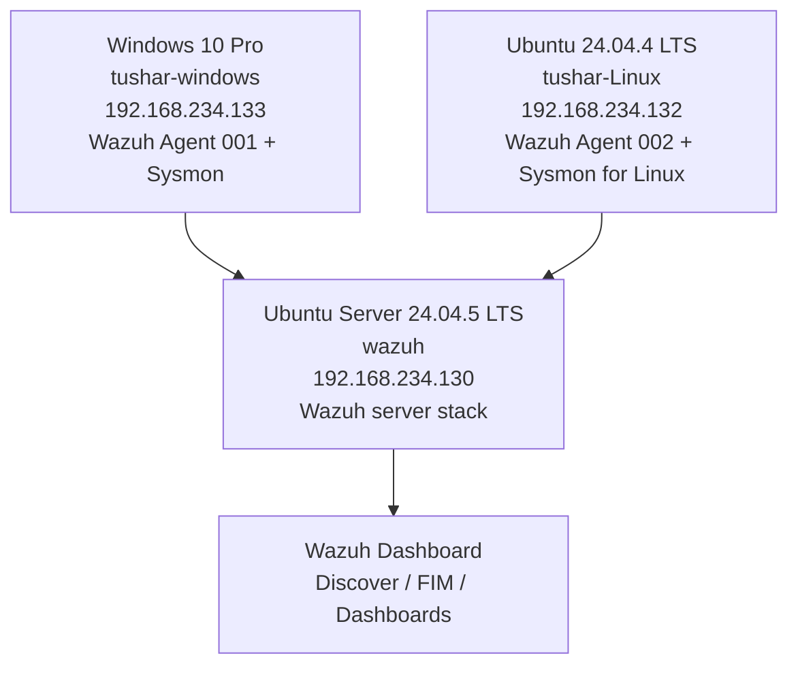

# Lab Architecture

## Topology

## Components and responsibilities

  -----------------------------------------------------------------------
  Component                           Responsibility
  ----------------------------------- -----------------------------------
  Windows endpoint                    Produces Windows Security and
                                      Sysmon telemetry

  Ubuntu endpoint                     Produces Linux authentication and
                                      Sysmon for Linux telemetry

  Wazuh server                        Receives endpoint data, evaluates
                                      rules, and supports central
                                      analysis

  Wazuh Dashboard                     Used to review agents, Discover
                                      events, FIM events, alerts, and
                                      visualizations
  -----------------------------------------------------------------------

## Data flow

1.  Wazuh agents collect configured endpoint data.
2.  The agents forward telemetry to the Wazuh server.
3.  Wazuh decoders and rules process incoming events.
4.  Events and alerts are indexed for searching and visualization.
5.  The analyst uses Discover and dashboard views to investigate
    activity.

## VM inventory

The operating systems, hostnames, and IP addresses below are visible in
the supplied evidence. CPU, RAM, disk allocation, and VMware network
mode were not visible in the supplied VM screenshots and are not
asserted.

  --------------------------------------------------------------------------
  VM                Hostname           OS                IP
  ----------------- ------------------ ----------------- -------------------
  Wazuh server      `wazuh`            Ubuntu Server     `192.168.234.130`
                                       24.04.5 LTS       

  Windows endpoint  `tushar-windows`   Windows 10 Pro    `192.168.234.133`
                                       10.0.19045.3803   

  Ubuntu endpoint   `tushar-Linux`     Ubuntu 24.04.4    `192.168.234.132`
                                       LTS               
  --------------------------------------------------------------------------

## Agent status

The supplied Wazuh Endpoints screenshot shows: - Agent `001`,
`tushar-windows`, status **Active**, version `v4.14.9`. - Agent `002`,
`tushar-Linux`, status **Active**, version `v4.14.9`.

See `../09-Evidence/02-active-agents.png`.
