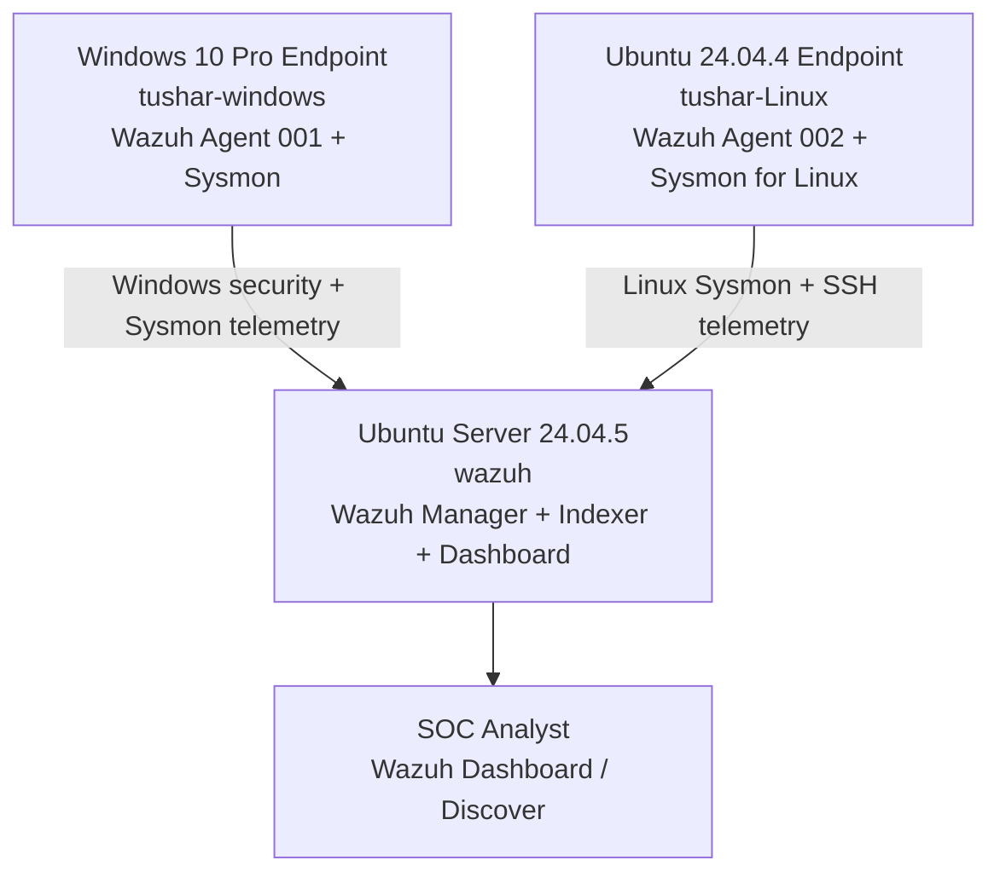

# Wazuh SIEM SOC Analyst Home Lab

A hands-on SOC monitoring and detection lab built with **Wazuh** on VMware, using one SIEM server and two monitored endpoints (Windows and Ubuntu Linux).

The project demonstrates endpoint onboarding, Windows/Linux telemetry review, a custom SOC dashboard, File Integrity Monitoring (FIM), custom detection rules, SSH brute-force correlation, and Wazuh Active Response.

> **Project scope:** This is an educational home lab. The evidence documents the events and configurations visible in the supplied screenshots; it is not a production SOC deployment or a real-world compromise.

## Architecture

## Environment

| Component | Details visible in evidence |
|---|---|
| Wazuh server | Ubuntu Server 24.04.5 LTS, hostname `wazuh`, `192.168.234.130` |
| Windows endpoint | Windows 10 Pro build `10.0.19045.3803`, agent `tushar-windows` (ID `001`), `192.168.234.133` |
| Linux endpoint | Ubuntu 24.04.4 LTS, agent `tushar-Linux` (ID `002`), `192.168.234.132` |
| Agent version | `v4.14.9` as displayed in the Agents view |
| Virtualization | VMware Workstation; see 12 screenshots in `09-Evidence/VMware-Configuration/` |

Both endpoint agents are shown as **Active** in the supplied Agents screenshot. Exact VM resource allocations and network adapter settings are documented by the VMware screenshots rather than inferred in this README.

## Implemented and evidenced work

- Deployed a Wazuh SIEM server on Ubuntu Server.
- Connected Windows and Ubuntu endpoint agents.
- Collected and reviewed Windows Sysmon and Linux Sysmon for Linux telemetry.
- Reviewed Windows Security events and Linux SSH authentication failures.
- Created a dashboard named **Tushar Tyagi SOC Activity Overview**.
- Configured FIM and observed file modification and deletion events for `C:\companydata\payroll.txt`.
- Created a custom Windows Guest-account enablement detection rule (`100200`).
- Created SSH repeated-authentication-failure detection (`100101`).
- Observed Wazuh `firewall-drop` Active Response event (`651`).

## Detection and response evidence

| Rule / event | Purpose | Evidence |
|---|---|---|
| Custom rule `100200` | Windows Security Event ID `4722`, target account `Guest`; rule level 12 | `09-Evidence/09-custom-windows-rule.png` |
| Custom rule `100101` | SSH login failures correlated from the same source IP; frequency 3 within 120 seconds | `09-Evidence/10-ssh-bruteforce-alert.png` |
| Wazuh rule `651` | Active Response log message: host blocked by `firewall-drop` | `09-Evidence/11-active-response.png` |
| FIM rule `550` | File integrity checksum changed / file modified | `09-Evidence/08-file-integrity-monitoring.png` |
| FIM rule `553` | File deleted | `09-Evidence/08-file-integrity-monitoring.png` |

The SSH rule screenshot shows `<if_matched_sid>5760</if_matched_sid>`, `<same_source_ip />`, `frequency="3"`, and `timeframe="120"`. See `06-FIM-and-Custom-Rules/local_rules.xml` for the screenshot-transcribed rules. **Verify that file against the live manager configuration before applying it.**

## Repository contents

| Folder | Description |
|---|---|
| `01-Architecture/` | Lab topology and VM inventory |
| `02-Wazuh-Server/` | Server installation and archive configuration notes |
| `03-Endpoint-Agents/` | Windows, Ubuntu and Sysmon setup notes |
| `04-Log-Analysis/` | Windows and Linux telemetry review |
| `05-SOC-Dashboard/` | Custom dashboard documentation |
| `06-FIM-and-Custom-Rules/` | FIM, custom Windows detection and XML rules |
| `07-SSH-Brute-Force-and-Response/` | SSH detection and Active Response |
| `08-Incident-Investigation/` | Investigation timeline and incident report template |
| `09-Evidence/` | Wazuh screenshots, VMware screenshots and evidence index |
| `10-References/` | Tools and documentation references |

## Skills demonstrated

- SIEM fundamentals and Wazuh architecture
- Endpoint onboarding and agent health monitoring
- Windows and Linux security telemetry analysis
- Sysmon event review
- Wazuh Discover and dashboard creation
- File Integrity Monitoring
- XML-based custom detection rules
- SSH authentication-failure correlation
- Active Response validation
- Evidence collection and incident documentation

## Safety and limitations

All activity was performed in an educational virtual lab. Use Active Response tests only on systems you own or are authorized to administer. The screenshots show private lab-network addresses; review them before publishing if you do not want to disclose local hostnames or IPs.

The repository does not claim malware analysis, Nmap scanning, Kali-based attack simulation, or real-world incident response. Only the activities supported by the included evidence are described.

## Author

**Tushar Tyagi**
